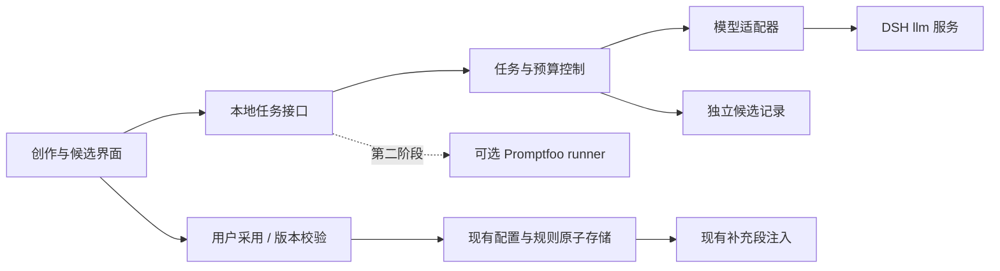

# Prompt Lab 0.6：AI 创作与验证方案

状态：0.6.0 已按本方案完成，交付与证据见 [0.6.0 记录](release-0.6.0.md)；0.6.1 / 0.6.2 仍为后续建议。设计基线：0.5.4 / `a77dc35`。日期：2026-11-07。

## 1. 产品目标与决策

把默认流程改为“描述目标 → AI 起草 → 按反馈修改 → 试跑对比 → 采用”，让用户主要提供目标、样例和选择。现有编辑器、配置存储与注入能力继续承载最终资产。

用户不需要先决定“这句话写正文还是共享规则”。创作入口以整套方案为单位，AI 建议拆分，界面再说明哪些只属于本方案、哪些值得复用；不为凑规则库把每条要求都强行拆成共享规则。

推荐技术路线：**原生轻量创作层 + DSH 模型适配器 + 后续可选的 Promptfoo 评测进程**。参考 prompt-optimizer 的交互和 ACE 的增量规则维护方式；不把完整平台或多个优化框架一起塞进宿主。

第一版完成生成、定向修改、规则提取、差异预览和另存新方案。这一版的成功标准是用户不用先学提示词工程，也不用先手写规则库，就能完成一份可修改、影响范围清楚的方案。

## 2. 已证实的边界

| 事实 | 对设计的约束 |
| --- | --- |
| 当前 `selected` 是进程共享状态，`evaluate(context)` 没有按会话选择配置 | 新方案保存不自动启用；启用明确提示影响当前 DSH 后续组装。项目标签不宣称实现会话/项目隔离 |
| 共享规则仅由配置的 `ruleIds` 引用，库内存在不等于全局注入 | 规则候选默认只关联新方案；不默认覆盖被多个配置引用的旧规则 |
| 插件贡献 5100/5101 两个补充段 | AI 生成补充指令，不重写 DSH 的整份系统提示词、工具定义或权限策略 |
| 已有 item version、storeVersion、409 与原子落盘 | 候选采用要延续版本检查，多条规则与配置必须一次提交 |
| 当前代码没有生成任务层和评测层 | 增加独立模块，生成故障不应使现有注入/管理失效 |
| 当前组装快照是进程最近观察，不是聊天记录 | 不将它当成“当前会话学习”的材料 |

本机 DSH 0.2.2-rc.1 源码已证明存在 `ctx.llm.prepareCall(config, signal)` 与 `call.stream(options)`。官方会话标题模块直接提供专用 `system`、`messages`、`purpose` 和 `signal`，未经过 `systemPrompt.assemble`。因此可构建独立辅助生成路径，不自动带入当前 Prompt Lab 补充段，也不启动 Agent 工具执行。

该调用仍经过宿主 `llm/stream` 钩子；不能承诺绕过其他插件的观察或处理。这里只完成源码核查，真实模型联通、各渠道结构化输出与取消仍是开工验证项。

宿主另有 `sessionQuery`，可按逻辑 sessionId 读取会话/模型表面。前端当前会话 ID 的取得和片段选择契约尚需验证，首版使用手动选择/粘贴的材料即可，不因此阻塞 AI 创作。

## 3. 用户实际如何使用

### 3.1 描述需求生成

例如输入：“帮我维护 Java 项目，中文回复，先定位相关代码，改完验证，不要每次输出长计划。”

1. 点击“AI 创作”，输入这句话；可选带入当前草稿或选定材料，不强迫填写长表单。
2. AI 整理目标。确实影响结果时才追问 1–2 个必要问题；测试命令、业务规则未知时列为待补充，不编造。
3. 先给一份候选，包含配置名、补充正文、配置专属规则、可复用规则建议和待确认项。用户需要时再生成另一版，减少无意义候选和调用。
4. 用户继续说“更短”“先给结论”“保留原来的验证要求”，得到定向修改及差异说明。
5. 主操作“另存为新方案”，一次采用正文与勾选规则。首版次操作为“仅替换正文与附加规则”，明确不写入新共享规则，仍需用户随后保存；新共享规则请随新方案提交。
6. 保存不等于启用。用户主动启用后，才改变当前 DSH 之后的统一组装选择。

候选在未保存前不计入当前 20 套配置上限。达到上限时保留候选，提示管理旧配置或选择替换目标，不自动删除旧资产。

### 3.2 优化当前稿

入口紧邻编辑器。自动带入当前草稿和已引用规则的快照，用户只需说想解决的问题。

候选展示实际增删内容、改变的行为、保留的约束和待验证项。不用“提示词变长”表示优化，不把模型自评包装成质量结论。第一版先支持整稿采用，段落级采用可在稳定差异算法后添加。

生成时可继续编辑，但返回值只进入候选区，不自动覆盖编辑器。切换配置后结果仍归原目标；旧草稿生成的候选显示“基于旧草稿”，需要重新比较再采用。

### 3.3 从材料整理规则

规则库增加“AI 整理规则”：可从当前配置、选定现有规则或粘贴的项目规范/纠正意见开始。

AI 负责提出规则、去重、指出冲突、建议合并，并区分长期习惯、项目事实和一次性任务要求。用户批量勾选候选即可，不逐条手写正文。

例：“这次又没有跑测试就说完成了”可以形成候选“涉及代码修改时执行适用验证；无法执行时说明原因”。“今天只看订单 123”应留在本次任务，不沉淀为长期规则。未知测试命令不能凭空补成 `npm test`。

## 4. 界面安排

继续保留现有四个主导航，不为每种 AI 操作新增一个页面。

- 提示词页突出“AI 创作”，编辑器中提供“按反馈优化”。宽屏使用抽屉/候选工作区，窄屏改为占满内容区的上下布局。
- 创作区：需求输入、所选材料摘要、生成模型、生成/取消。
- 候选区：正文与规则建议、原稿/候选差异、实质修改说明、待补充项、采用方式。
- 规则库：新增“AI 整理规则”，候选卡展示来源、适用配置、重复/冲突、建议动作，可批量采用。
- 第二阶段在候选区增加“试跑”，并排显示当前版与候选版结果，不扩张全局分析仪表板。
- 手工编辑继续提供；正常使用可由 AI 起草，再作少量修订。

## 5. 规则与来源的具体设计

每条候选至少保留：正文、名称建议、来源类型/引用片段、适用理由、建议动作、已有规则关联、冲突提示、未验证状态。

建议动作仅有三类：引用未改动的已有规则、创建新规则、复制旧规则后修改。模型提供的是建议，不直接决定数据库 ID。

- 已有规则没有变化：可引用原规则，但采用前核对版本。
- 已有共享规则需要变化：默认创建新规则，只重连新方案，保留原规则和其他引用配置。
- 原地修改共享规则：作为明确的高级动作，显示全部受影响配置和差异，沿用版本校验。
- 项目来源/标签先作为筛选与解释信息。真正自动按项目/会话适用需要后续路由实现与隔离测试。
- 不自动扫描整个磁盘或全部聊天；生成前显示选定材料的来源与长度，材料可取消勾选。

## 6. 模型接入与运行结构



### 6.1 宿主适配优先

- 首选从 DSH 的可用模型配置选择，后端解析供应商和凭据，UI 不接收或重复保存 API Key。
- 选择优先级为“本次明确选择 → Prompt Lab 保存的模型对 → DSH 默认模型”。已核实 `agentDefaultModel.currentSelection()`、`llm.listProviders()` 和 `llm.listModels(provider)`；首版不承诺自动跟随当前会话尚未发送的新模型选择。
- 起草模型与目标测试模型分开选择；测试默认与真实目标模型一致。不能把昂贵模型润色过的文本自动判定为目标模型上的改进。
- 生成时使用专用元提示词、用户目标及选定材料，显式不开工具、不启动 Agent loop、不修改当前会话。当前草稿/规则可以作为用户选定的“待编辑数据”传入，应与辅助生成的系统指令分隔；不经 systemPrompt.assemble 自动把它们当作辅助调用的指令注入。
- 缓冲并校验完整结构后产生候选；可显示进度和文本预览，但不允许采用半截 JSON。
- 各模型对结构化输出支持不一：优先受支持的结构化能力，兼容严格 JSON 校验，最多一次格式修复，不无限重试。
- 自定义兼容 API / 外部 MCP 只作为后续适配器候选；不把多套模型配置一次暴露给用户。

`prepareCall` 返回的调用路由为一次性使用：每次派发先锁定本次模型/参数，再消费一次 stream，不能在用户更换下拉项后让同一任务悄悄换模型。用途标记用于归因，不是跳过其他插件钩子的隔离开关。

辅助生成不经过现有 `systemPrompt.assemble`，也就不会自动经过那条路径的环境过滤/身份句兼容。现有“隐藏具体值”不等于会清理创作材料；生成前须显示材料发送范围。若增加创作材料脱敏，应作为独立预处理、显示变化并保留原稿。辅助请求的渠道兼容应单独适配验证，不能宣称已有开关必然覆盖。

### 6.2 依赖隔离

新增独立的 AI 服务插件行，依赖 `llm`；已有注入行仍只依赖 `systemPrompt`，已有 UI 仍只依赖 `webServer`。共享任务层在 AI 服务不可用时返回明确状态，管理和注入继续可用。

拟新增模块：

| 模块 | 职责 |
| --- | --- |
| `lib/ai.js` | 适配 DSH llm，注册/注销模型能力，卸载时中止辅助任务 |
| `lib/studio/jobs.js` | 任务状态、并发、取消、超时和预算 |
| `lib/studio/templates.js` | 生成、改写、规则提取的少量版本化元提示词 |
| `lib/studio/contracts.js` | 输入/输出结构、长度、来源与引用校验 |
| `lib/studio/store.js` | 本地候选与必要元数据，限量保留、清除与恢复 |
| `lib/studio/apply.js` | 候选到资产的原子转换、ID 映射、版本检查 |
| `lib/studio/evaluation.js` | 第二阶段的模型试跑与 runner 协议 |

模块名是建议，实施时以实际宿主契约收敛，不预先增加大型运行依赖。

## 7. 数据、任务与 API

### 7.1 任务输入与候选

任务固定保存生成所依据的 `profileId`、profile version、草稿哈希、引用规则版本、材料摘要、模型引用和元提示词版本。生成中资产变化不会偷偷切换任务输入。

候选契约大致为：

```text
candidateId / operation / createdAt
base: profileId + profileVersion + draftHash + referencedRuleVersions
model: providerRef + modelId + supportedParameters
content: name + supplementalPrompt + localRules + proposedRuleOperations
explanation: changes + preservedConstraints + assumptions + questions
sources: explicit source references / selected excerpts
usage: dispatchedCalls + inputTokens? + outputTokens? + knownCost?
validation: schema status + warnings + verification status
```

外部引擎也必须转换为同一契约。禁止模型自由提交已有规则 ID、启用配置或执行命令。解析失败、超长、引用失效不进入可采用状态。

### 7.2 持久化策略

继续用 schemaVersion 2 保存已采用的 profiles/ruleSets，不为接入 AI 立刻迁移注入数据格式。

```text
DSH_HOME/prompt-lab/
  profiles.json              # 继续是注入资产的唯一事实来源
  settings.json              # 原环境信息与渠道兼容设置
  studio/
    settings.json            # 模型引用与预算，无 API Key
    jobs/<id>.json          # 有限任务状态与输入引用，支持启动时标为中断
    candidates/<id>.json    # 用户可见的候选与必要来源，有限保留
    runs/<id>.json           # 第二阶段的评测结果
    revisions/<id>.json     # 第二阶段的不可变版本快照
```

候选默认仅本地保存，拟保留最近 20 份，可清除；不长期记录整个聊天或全部执行轨迹。新记录能力应在产品和说明中可见，不能继续沿用“完全无历史记录”来描述它。

首版优先另存新方案，原方案直接作为回退点。完整版本回退放第二阶段：快照冻结正文、规则内容/顺序与开关，不能只存 ruleIds，否则旧规则后来变化会使“历史版本”失真。回退作为一次新的版本提交，保留当前版本并核对引用影响。

配置和规则采用应一次性构造新 store 后原子写入，并带 expectedStoreVersion / item version。已有导入的追加事务可借鉴，但当前导入总是复制冲突 ID，不能直接当作“复用已有规则引用”的完整实现。

首版“仅替换正文与附加规则”只改前端草稿，保持现有 ruleIds，不提前创建新规则；界面提示未采用的新共享规则。另存新方案通过专用 apply 事务创建所选规则与配置。将来如允许完整候选替换原配置草稿，需先增加 pendingRuleOperations/临时引用，并在用户保存时一次提交，不能采用时先写规则、之后再写配置。

候选来源和运行记录为辅助数据，不能使注入依赖它们成功读取。第二阶段若同时记录资产历史，应设计待提交记录/提交标识及启动恢复，明确处理“资产已提交但历史写入失败”，不能把两次文件写入称为单一事务。

### 7.3 本地任务接口

建议新增 `/prompt-lab/api/studio` 命名空间，沿用已有回环地址、同源、UI 自定义头和输入预算校验。

| 动作 | 语义 |
| --- | --- |
| 获取 capabilities | 服务是否就绪、可选模型、支持项、限制，不含凭据 |
| 创建 job | generate / revise / extract-rules，返回 jobId |
| 查询 job | 状态、进度和完整候选；独立增量版本，避免反复拉取全部提示词 |
| 取消 job | 中止当前调用及后续派发，不更改草稿 |
| 预览/采用 candidate | 映射规则、显示影响，核对基线后保存新方案或替换草稿 |
| 第二阶段 eval/run | 对冻结的测试集、模型和候选快照创建评测任务 |

状态：`queued → running → succeeded / failed / cancelled / timed_out / interrupted`。派发前持久化有限 job 状态；启动时将前一实例未终结任务标为 interrupted，不自动恢复并继续付费调用。HMR 同样处理。已完成候选保留，未完成结构不进入可采用状态。请求应带去重键，避免双击重复派发；任务状态和候选按保留策略一起清理。

### 7.4 预算建议

首版默认每次动作一次主调用，最多一次格式修复；模型自行追问后的用户答复属于新的可见动作。单编辑上下文同一时间运行一个生成任务。

建议初始上限：单调用 90 秒、输出 4000 Token、材料/输入按模型能力与显式预算截断或拒绝。具体数值在宿主联调后调整。预算决定是否派发下一次调用；无可靠价格时显示调用数和 Token，不显示“成本为 0”。

取消尽力中断供应商请求并阻止后续调用；已派发调用仍可能计费。晚到结果不能回写原稿。供应商 usage 缺失要标未知，不自行编造。

## 8. 评测与自动优化

### 8.1 文本试跑

固定目标模型、参数、同一测试输入与材料，比较当前版/候选版。组装的是冻结的测试上下文及候选补充段，不通过修改全局 selected 来“试用”候选。

第一步先支持当前补充提示词的文本行为试跑；完整 DSH 上下文重放能力需另行验证。面板明确测试覆盖范围，不把缺少工具/环境的聊天测试标成完整 Agent 验证。

AI 可起草第一批 5–10 个样例，用户从真实任务中补充/选定，覆盖正常、边界、曾经失败的情况。格式/字段等优先用确定性断言；语义质量使用冻结 rubric、展示理由。只显示“92 分”没有解释不算可用。

测试分成优化集与验证集；样本太少时明确“探索性结果”，不假装统计结论。调优期间不能不断查看和利用最终保留测试集。随机展示候选顺序、隐藏候选身份可减少模型评分偏向，但仍不等于客观真值。

结果展示：原始输出、每项检查、通过率、失败理由、Token、延迟、已知成本和变化。没有改进就保留当前版；更长或模型更喜欢不作为默认胜出条件。

### 8.2 Coding Agent 真实验证

真实能力要在相同仓库基线、任务、模型、工具与权限条件下，检查文件变更、测试退出码与任务完成证据。每个 A/B 分支必须使用独立宿主进程及隔离数据目录，或经过验证的按会话冻结注入路由；仅新建工作区/会话不隔离当前全局 selected。单次“回复说测试通过”不能算验证通过。

本阶段在宿主隔离路径明确前只做受限验证设计，不借切换全局配置在用户正在工作的会话中试验。文件操作任务也不能因“评测”名义自动在用户原工作目录执行。

### 8.3 优化引擎选择

[Promptfoo 当前已有 `optimize`](https://www.promptfoo.dev/docs/usage/prompt-optimization/)，会运行基线、根据失败/分数生成候选并评测，支持 validation split。第二阶段先验证同一个 runner 能否完成评测与有界优化，不急于再引入另一套引擎。

实际接入门槛：固定版本，确认目标 provider、改写模型、取消、调用/Token 预算和候选结果可控。官方文档指出改写由单独的 suggestions provider 生成，不能承诺自动共用 DSH 的当前模型；若版本接口无法满足预算和模型控制，则只使用其 eval，优化循环由任务层有限编排。

GEPA 留作第三阶段备选，适用于确有可靠 evaluator、执行反馈和足够样例的任务。ACE 首先提供规则增量维护思路，首版只提取候选，不做无人值守自动学习与生效。

## 9. 开源复用取舍

| 路线 | 决策与理由 |
| --- | --- |
| 原生创作 + DSH llm | 首选，贴合现有草稿、规则引用和原子提交；没有额外独立服务的常驻负担 |
| prompt-optimizer MCP | 保留可插拔路线，适合愿意独立部署的用户；不把 MCP 工具调用当成已解决资产采用、规则提取和评测 |
| prompt-optimizer core/UI 深嵌 | 首版不选，当前 core 为 private 工作区包，模型 SDK/资产/存储体系与本插件重叠；源码复用需固定版本评估许可 |
| Promptfoo runner | 第二阶段可选，隔离于注入进程，复用测试与结果，不默认带整套平台 |
| GEPA / PromptWizard / ACE 全栈 | 后续按需求验证，避免同时维护 Node、Python 和多个模型配置体系 |

核查当日 prompt-optimizer 的 MCP 包声明 Node `^24.22.1`，本机 DSH Node 为 `24.21.0`；不能把当前 MCP 包直接装入宿主并承诺可运行。其 core 包 `private:true`、`version:0.0.0`，不能当成已确认稳定的公共 npm SDK。

Promptfoo 当前 Node API 要求 Node >=22.22.0，现有插件声明 Node >=18。可选 runner 应有自己的受支持运行时与版本检查；不能仅为评测功能提高整个插件最低运行要求。

## 10. 分阶段交付与验收

| 阶段 | 交付内容 | 必须通过的验收 |
| --- | --- | --- |
| 开工验证 | DSH 模型枚举/解析、专用消息生成、流式取消、错误/usage、能力隔离 | 一次真实生成成功；取消与不支持能力可解释；不调用工具，不修改现有注入或用户配置 |
| 0.6.0 AI 创作 | 生成、定向改写、规则提取、候选差异、另存新方案、预算/取消、来源记录 | 一句话生成可用补充方案；未知内容待补充；失败/取消/旧响应/409 保留原稿；不静默修改共享规则和启用项 |
| 0.6.1 试跑与版本 | 样例辅助生成、两版对比、基础评分、冻结版本与回退；可选 Promptfoo | 冻结输入可追溯；验证集不参与优化；失败不算通过；旧版本回退恢复规则内容与顺序；runner 故障不影响注入 |
| 0.6.2 反馈迭代 | 显式选定会话/反馈提取、规则去重修剪、预算受控优化；按需求评估 GEPA | 有真实来源与结果证据；不拿进程快照当聊天；无提升保留原版；若加入自动范围适用，必须有真实路由和跨会话隔离测试 |

0.6.0 不包含：无人值守自我学习、扫描全部聊天/磁盘、自动改写宿主系统提示词、自动启用、完整 Coding Agent 基准平台。以上是范围约束，避免第一版因周边系统迟迟不能使用。

## 11. 关键回归场景

1. 生成期间继续编辑、切换配置、切走宿主页签；结果只归原任务。
2. 多窗口修改配置或引用规则；采用时冲突可见，不能强制覆盖。
3. 用户取消、超时、供应商限流、空结果、非法 JSON、超长输出与未知引用。
4. 新方案含多条新规则时磁盘写入失败；配置/规则均不部分提交。
5. 优化共享规则时只有新方案引用副本，其他配置字节不变。
6. 达到配置/规则/预算上限；候选可保留，不能静默丢弃或扩容。
7. 模型服务、runner 或新增 sidecar 损坏/不可用；已有管理与注入仍工作。
8. AI 起草不自动将当前补充段当系统指令注入；用户明确选定的当前稿/规则可作为待编辑材料传入，不污染真实会话/组装诊断。其他 llm 钩子影响需记录。
9. 1200 / 520 / 360px、明暗主题、键盘操作、流式进度和取消可见。
10. 热加载/宿主退出中断任务；重新打开不自动继续计费。

## 12. 来源与验证状态

- 当前本地：`lib/state.js` 的全局 selected、evaluate、profileParts、commit；`lib/store.js` 的 schema 2、引用校验与原子保存；`lib/ui.js` 的同源本地接口。
- 本机 DSH：`@deepseek-ai/dsh-llm`、`@deepseek-ai/dsh-session-title-llm`、`@deepseek-ai/dsh-session-query` 的已安装 0.2.2-rc.1 源码，只读检查，未读取真实聊天或调用付费模型。
- [Prompt Optimizer core 包](https://github.com/linshenkx/prompt-optimizer/blob/develop/packages/core/package.json)、[MCP 包](https://github.com/linshenkx/prompt-optimizer/blob/develop/packages/mcp-server/package.json)、[MCP 工具说明](https://github.com/linshenkx/prompt-optimizer/blob/develop/docs/user/mcp-server.md)。
- [Promptfoo Node API](https://www.promptfoo.dev/docs/usage/node-package/)、[自定义 provider](https://www.promptfoo.dev/docs/providers/custom-api/)、[优化流程](https://www.promptfoo.dev/docs/usage/prompt-optimization/)。
- [ACE](https://github.com/ace-agent/ace)、[GEPA](https://github.com/gepa-ai/gepa)、[PromptWizard](https://github.com/microsoft/PromptWizard)。

实施前固定所采用版本并做接口冒烟测试；不将开源项目的公开 benchmark 收益直接当成本插件的预期收益。本文首先形成于设计阶段，随后已完成 0.6.0 的宿主模型验证、实现和交付。

0.6.0 的实现收敛：候选、冻结输入、任务和采用记录合并保存在 `studio/jobs/<id>.json`，没有另建 candidates 索引；任务/记录职责由 jobs.js 承担，采用事务位于 state.js 的 applyStudioCandidate。实际预算为整个任务 90 秒，比原建议的单调用 90 秒更严格。各项 0.6.0 验收见交付记录。

### 本机宿主证据索引

公共宿主代码的只读副本位于仓库外层 `.scratch`，便于复核；没有用户会话或凭据。

| 文件及行 | 内容 |
| --- | --- |
| `host-contract-dsh-agent-default-model.js:39` | 默认模型选择，不返回密钥 |
| `host-contract-dsh-llm.js:1908` / `:2086` | provider/model 目录 |
| `host-contract-dsh-llm.js:2225` / `:2254` | prepareCall 与一次性 stream |
| `host-contract-dsh-llm.js:2402` | llm/stream waterfall，仍可能被其他插件处理 |
| `host-contract-dsh-session-title-llm.js:181`–`:210` | 官方专用 system/messages/purpose/signal 调用实例 |
| `host-contract-dsh-llm-pi-ai.js:1278`–`:1302` | 空工具集合处理 |
| `host-contract-dsh-session-query.js:1072` / `:1081` / `:1168` | 会话列表、完整事件与表面事件读取 |
