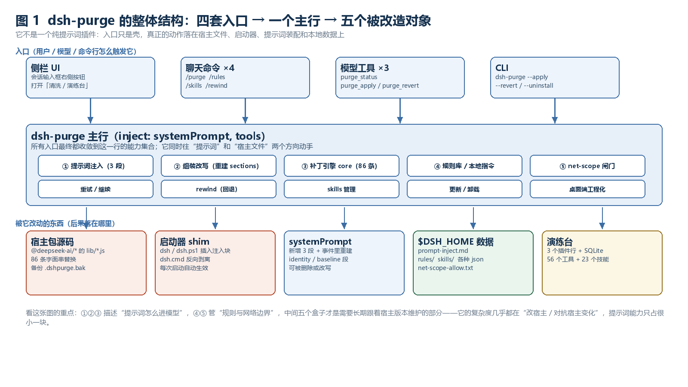
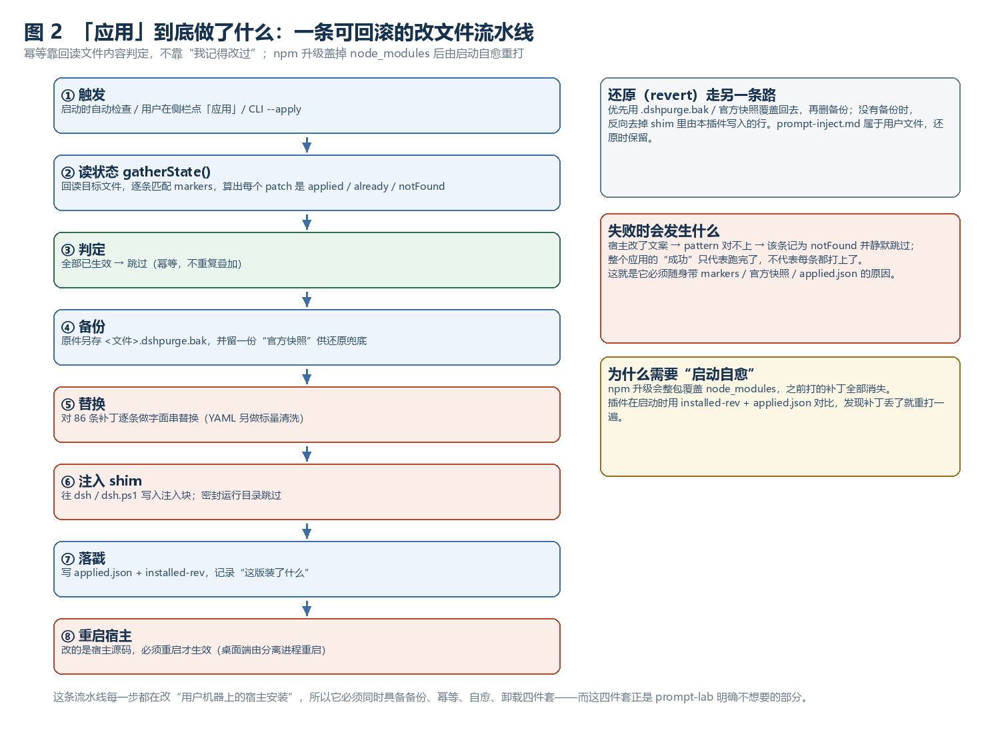
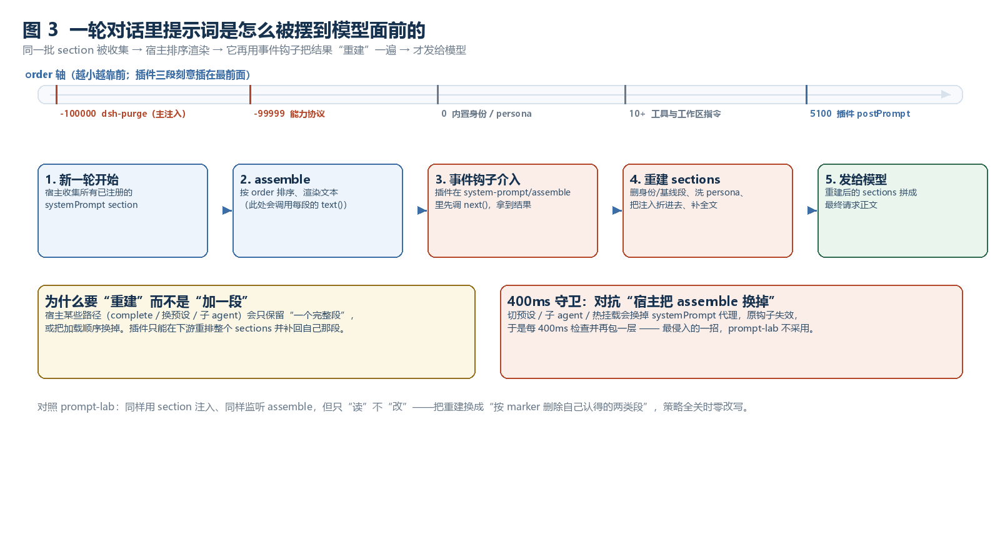
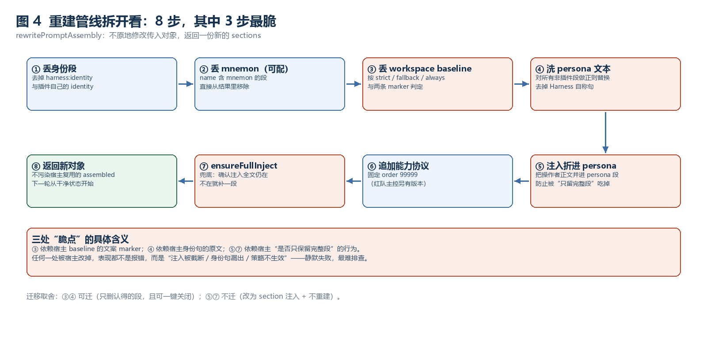
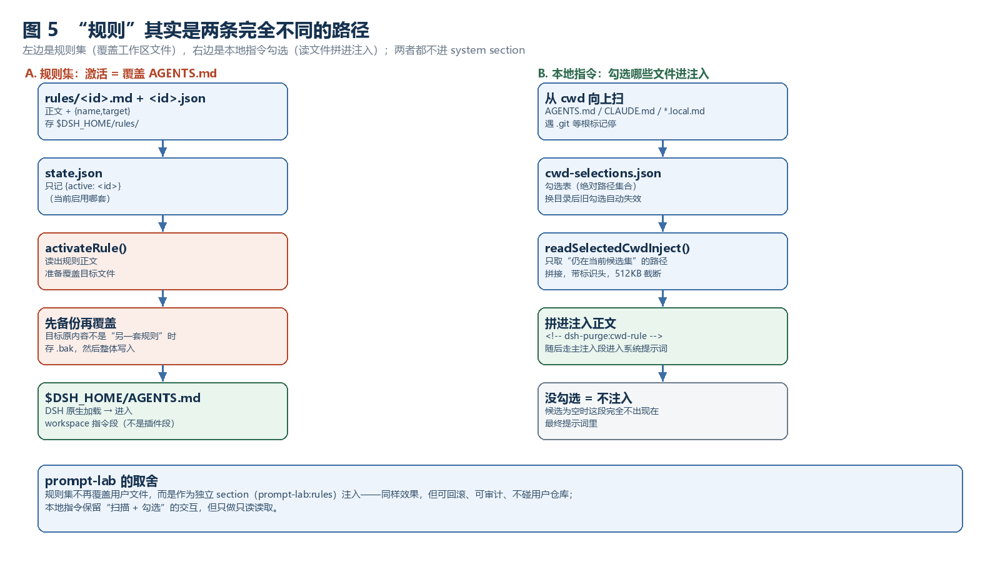
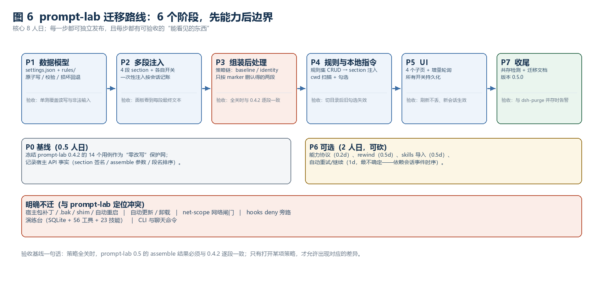
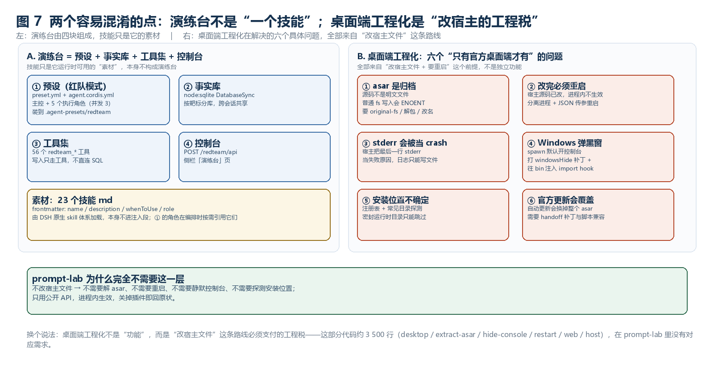

# 图文详解：dsh-purge 每一步到底在干什么

> 配套文档：[功能详解与对比报告](./dsh-purge-report.md)｜[迁移计划](./migration-plan.md)
> 七张图回答七个问题：它长什么样 → 应用时做了什么 → 一轮对话里提示词怎么流动 → 改写管线怎么拆 →
> “规则”为什么有两条路 → 迁移怎么排 → 演练台与桌面端工程化到底在解决什么。

---

## 图 1　它长什么样：四套入口、一个主行、五个被改造对象

**看图顺序**：从上往下。

1. 四个入口（侧栏 / 聊天命令 / 模型工具 / CLI）都只是壳，最终都收敛到中间的**主行**。
2. 主行里十个能力块，真正决定"效果"的只有前三块：**注入**（往里加段）、**改写**（把结果重建）、**补丁**（改宿主源码）。
3. 最下面是**后果落点**：宿主包文件、启动器、`systemPrompt`、`$DSH_HOME` 数据、演练台。
   左侧两个红框是"改了会被 npm 升级冲掉"的部分，右侧蓝/绿/黄框是"数据与插件自身"。

**一句话结论**：它的复杂度不在提示词，而在"改宿主 + 对抗宿主变化"。这也解释了为什么它能做的事很多，
但维护成本几乎全部来自"跟着宿主版本改那 86 条补丁"。

---

## 图 2　「应用」到底做了什么：一条可回滚的改文件流水线

**看图顺序**：左侧八步是主流程，右侧三块是"另外三条必须存在的支线"。

| 步骤 | 关键点 |
| --- | --- |
| ① 触发 | 启动自检 / 侧栏按钮 / CLI，三处入口共用一套流程 |
| ② 读状态 | **回读文件内容**匹配 markers，不是靠"我记得改过"——所以手动改回去也能识别 |
| ③ 判定 | 已生效就跳过，保证幂等（否则每次 apply 都会叠加，作者实测过 +841 字符/次不收敛） |
| ④ 备份 | `.dshpurge.bak` + "官方快照"，后面还原全靠它 |
| ⑤ 替换 | 86 条补丁逐条做**字面串替换**（不是 AST 改写） |
| ⑥ shim | 把 `dsh` / `dsh.ps1` 启动器也改了，让下次启动自动带补丁 |
| ⑦ 落戳 | `applied.json` + `installed-rev`，记录"这版装了什么" |
| ⑧ 重启 | 改的是宿主源码，必须重启才生效 |

**三条支线**：还原（用备份回滚）、失败静默（pattern 对不上就记 `notFound` 跳过）、启动自愈（npm 升级后自动重打）。

---

## 图 3　一轮对话里，提示词是怎么被摆到模型面前的

**看图顺序**：先看上面的 order 轴，再看下面五步。

1. **order 轴**：插件三段刻意插在**最前面**（`-100000` 主注入、`-99999` 能力协议），比任内置段都靠前；
   postPrompt 在 `5100`，排在常规段之后。
2. **第 3 步是关键分叉**：普通插件到这里就结束了（组装结果直接发模型），它却要**接管事件**、调 `next()` 拿结果、再重建。
3. **第 4 步**就是"重建"：删身份段、删 mnemon、按策略删 workspace baseline、洗 persona、把注入折进去、补全文。
4. 右下角那张"400ms 守卫"解释了它为什么要反复重包 `assemble`——宿主切预设/子 agent 会换掉代理，钩子会丢。

**一句话结论**：它不是"加一段提示词"，而是"在宿主排好版之后，把整页重新排版一遍"。

---

## 图 4　重建管线拆开看：8 步，3 个脆点

| 步骤 | 做什么 | 脆不脆 |
| --- | --- | --- |
| ① 丢身份段 | 移除 `harness:identity` 与插件自己的 identity | 稳（按 name） |
| ② 丢 mnemon | name 含 mnemon 的段整体移除（可配） | 稳（按 name） |
| ③ 丢 workspace baseline | 按 `strict/fallback/always` + 两条 marker 判定 | **脆**：marker 是宿主文案 |
| ④ 洗 persona 文本 | 对非插件段做正则替换，去掉 Harness 自称句 | **脆**：依赖原句 |
| ⑤ 注入折进 persona | 把操作者正文并进 persona 段 | **脆**：依赖"只留完整段"的行为 |
| ⑥ 追加能力协议 | 固定 `order 99999` | 稳 |
| ⑦ ensureFullInject | 兜底确认注入全文仍在 | **脆**：同⑤ |
| ⑧ 返回新对象 | 不污染宿主复用的对象 | 稳（好习惯） |

**关键洞察**：这 8 步里所有"脆"的地方，失败时都**不报错**——表现是"注入被截断 / 身份句漏出 / 策略不生效"。
这就是为什么迁移时只保留 ③④（可关闭、只删认得的段），而放弃 ⑤⑦。

---

## 图 5　“规则”其实是两条完全不同的路径

**左路（规则集）**：`rules/<id>.md` + `state.json` → `activateRule()` → **先备份再整体覆盖** `$DSH_HOME/AGENTS.md`
→ 由 DSH 原生加载成 workspace 指令段。注意：**它不经过插件自己的 section**，是"改用户文件"。
**右路（本地指令）**：从 cwd 向上扫 → 记勾选表 → 只取"仍在候选集"的路径 → 拼接进注入正文（带 `<!-- … -->` 头）。

**两条路的共同点**：都不进 `systemPrompt.section`。这解释了为什么它需要 F05 的 baseline 策略来"腾位置"——
工作区段本身就是宿主塞进系统提示词的那一大块。

**prompt-lab 的取法**：规则集改成独立 section 注入（不写用户文件），本地指令只读。

---

## 图 6　迁移怎么排：6 个阶段，先能力后边界

- **P1 数据模型**是地基：`settings.json` + `rules/`，先有地方存，才谈得上开关。
- **P2 多段注入**把"一段"变"四段"，每段独立开关——这一步就能覆盖它 60% 的提示词相关能力。
- **P3 组装后处理**是唯一改 `assemble` 的环节，也唯一需要"零改写回归基线"来兜底。
- **P4/P5** 是规则与界面；**P7** 收尾做共存检测与文档；**P6** 可选（重试/rewind/skills）。
- 红色那条"明确不迁"就是图 1/图 2 里最重的部分：补丁、shim、自愈、更新、net-scope、演练台。

---

## 图 7　两个容易混淆的点：演练台不是“一个技能”；桌面端工程化是“工程税”

**① 演练台 ≠ 技能。** 它是四块东西的组合：

| 组成 | 具体是什么 | 落在哪 |
| --- | --- | --- |
| 预设（红队模式） | `preset.yml`（名称/描述/order）+ `agent.cordis.yml`（主控 + 5 个执行角色，并发 3） | `$DSH_HOME/.agent-presets/redteam/`，出现在模式下拉里 |
| 事实库 | `node:sqlite` 的 `DatabaseSync`，按靶标分库、跨会话共享 | `$DSH_HOME/redteam/` |
| 工具集 | 56 个 `redteam_*`（资产/漏洞/凭据/webshell/隧道/评分/报告/PoC…） | 注册在 `tools` 服务上 |
| 控制台 | `POST /redteam/api` + 侧栏「演练台」页 | 浏览器端 |

那 23 个 `skills/redteam/*.md` 只是**素材**：frontmatter 是 `name / description / whenToUse / role`，
由 DSH 原生 skill 体系加载，**本身不进注入段**；红队角色在编排时按需引用它们。
一句话记住：**技能是一份说明书，演练台是一个 agent 模式 + 数据库 + 工具面 + UI**。

**② 桌面端工程化不是功能，而是“改宿主文件”必须支付的工程税。** 它解决的是六个具体问题：

| 问题 | 为什么会出现 | 它怎么处理 |
| --- | --- | --- |
| asar 是归档 | 官方桌面端把源码打进 `app.asar`，Electron 还会把 `resources/app` 映射进去，普通写入直接 ENOENT | `original-fs`、必要时解包/改名再换回 |
| 改完必须重启 | 改的是已读进内存的宿主源码 | 分离进程 + JSON 环境变量传参重启 |
| stderr 会被当 crash | 宿主把最后一行 stderr 当失败原因 | 日志只写临时文件，绝不走 stderr |
| Windows 弹黑窗 | `spawn` 默认开控制台窗口 | 给 `child_process` 打 `windowsHide` 补丁 + 往 bin 注入 import hook |
| 安装位置不确定 | 注册表 / 常见目录 / 便携版 / 密封运行时都可能 | 探测 + 白名单，密封目录直接跳过 |
| 官方更新会覆盖 | 自动更新换掉整个 asar | handoff 补丁 + 脚本 UTF-8/ASCII 兼容 |

这部分代码合计约 **3 500 行**（desktop 1 778 / extract-asar 462 / hide-console 324 / restart-desktop 472 /
restart-web 103 / web 107 / host 28 / official-update 52 / settle-policy 61 / child-process-hide 87）。
prompt-lab 不改宿主文件，所以这六件事一件都不需要——这也是迁移计划里把它整块列为“不迁”的原因：
**不是难，是前提不同**。

---

## 一页纸对照（把七张图压成一句话）

| 问题 | dsh-purge 的做法 | prompt-lab 的做法 |
| --- | --- | --- |
| 提示词怎么进模型？ | 三段 section（order -100000）+ 事件里**重建** | 一段 section + 只读观察 |
| 怎么保证"一定生效"？ | 改宿主源码 + shim + 重启 + 400ms 守卫 | 公开 API，进程内即生效 |
| 规则放哪？ | 覆盖 `AGENTS.md` | 独立 section |
| 本地指令？ | 扫描 + 勾选 + 拼进注入 | 同交互，只读 |
| 出错怎么办？ | 静默 `notFound` / 截断 | HTTP 错误码 + 面板提示 |
| 怎么回滚？ | `.bak` + 官方快照 + 卸载流程 | 关插件即回原状 |
